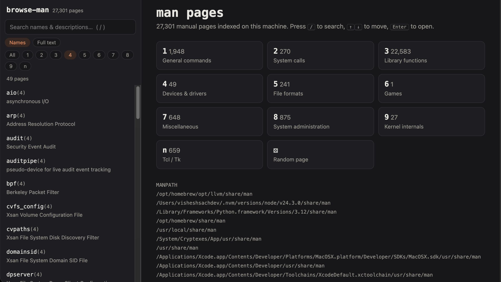

# browse-man

Browse, search, and read **every man page on your Mac** in your web browser.



`browse-man` finds all man pages on your `MANPATH` (system, Xcode, Homebrew, nvm, …), builds an index of names and one-line descriptions, and serves a fast local web app for exploring them:

- **Instant search** over ~25,000+ page names and descriptions
- **Full-text search** inside every page
- **Filter by section**: 1 commands, 2 syscalls, 3 library, 5 file formats, 8 admin, …
- **Clickable cross-references**: `SEE ALSO` links like `ls(1)` or `kqueue(2)` open the page
- Table of contents for each page, keyboard navigation, dark mode, bookmarkable URLs
- Shows aliases (`bunzip2 → bzip2`) and other sections with the same name (`printf(1)` / `printf(3)`)

**No dependencies.** It's a single Python file that uses only the standard library. Pages are rendered by `mandoc`, which ships with macOS. Nothing leaves your machine, and the server only listens on `127.0.0.1`.

## Why another man page viewer?

Many man page tools and scripts work fine on Linux but have problems on macOS. These are the usual causes and how `browse-man` handles each one:

| Problem on macOS | What goes wrong | What `browse-man` does |
| --- | --- | --- |
| **`groff` was removed** in macOS 13 Ventura | Tools that render HTML with `groff -Thtml`, or depend on `groff` some other way, fail or need `brew install groff` | Uses `mandoc`, which ships with macOS 13+, to render HTML |
| **Online man sites show Linux pages** | Sites like man7.org document GNU/Linux tools. macOS uses BSD tools, so `ls`, `sed`, `date`, `stat` and others have different flags | Shows the pages that are actually installed on *your* Mac, matching the tools you run |
| **`apropos` / `man -k` give stale or empty results** | They rely on a `whatis` database that is often missing or out of date on macOS (rebuilding it takes `sudo /usr/libexec/makewhatis`) | Builds its own index straight from the page files. No database, no `sudo` |
| **Man pages live in many directories** | Pages are spread across `/usr/share/man`, the Xcode SDK and toolchains, `/System/Cryptexes`, Homebrew (`/opt/homebrew` or `/usr/local`), nvm, Python.framework and more. Tools that only look in `/usr/share/man` miss most of them | Asks `manpath` for the real search path, the same one `man` uses |
| **Apple's `python3` changes `MANPATH`** | `/usr/bin/python3` sets `MANPATH` to a few Xcode directories plus a trailing `:`. A script that splits `MANPATH` naively only sees those directories and misses everything else (in testing, 3 of 10 directories were found) | Treats an empty `MANPATH` entry the way `man` does, by inserting the system default path there |
| **Page files come in several forms** | Pages may be gzip-compressed (`*.1.gz`), symlinked aliases (`bunzip2.1 → bzip2.1`), or `.so` stubs that just point to another page | Reads gzip directly, follows `.so` redirects, and shows aliases |
| **Two page formats** | Pages are written in either mdoc (BSD style, `.Nd`) or man(7) (`.SH NAME`). Parsers that handle only one get blank descriptions or broken links | Handles both, and turns plain `name(N)` references in man(7) pages into links |
| **Python version and dependencies** | Scripts that need `pip install`, a newer Python, or Homebrew packages break on a clean Mac | One file, standard library only, runs on the stock Python 3.9 from the Xcode Command Line Tools |

## Install

```sh
curl -fsSL https://raw.githubusercontent.com/vishesh0123/browse-man/main/browse-man -o /usr/local/bin/browse-man
chmod +x /usr/local/bin/browse-man
```

Or clone the repo and run it in place:

```sh
git clone https://github.com/vishesh0123/browse-man.git
cd browse-man
./browse-man            # or: python3 browse-man
```

`./browse-man` and `python3 browse-man` do the same thing. Use `python3 browse-man` if you get `permission denied`, which can happen when the file was downloaded as a ZIP and lost its executable bit. You can also fix that with `chmod +x browse-man`.

Requirements: macOS 13+ (for the built-in `/usr/bin/mandoc`) and Python 3.8+ (the system `python3` works). It also runs on Linux and older macOS if `mandoc` is installed (`brew install mandoc`, `apt install mandoc`). Without `mandoc`, it falls back to plain-text rendering through `man`.

## Usage

```sh
browse-man                # index everything, open the browser
browse-man ls             # jump straight to ls(1)
browse-man printf.3       # or a specific section: printf(3)
browse-man --port 9000 --no-open
browse-man --rebuild      # re-read every page and ignore the cache
browse-man --manpath /opt/homebrew/share/man:/usr/share/man
```

### Keyboard

| Key | Action |
| --- | --- |
| `/` | Focus search |
| `↑` / `↓` | Move through results |
| `Enter` | Open page (in Full text mode, run the search) |
| `Esc` | Clear search |

## How it works

1. **Discover:** runs `manpath` and walks each `man*/` directory. As with `man(1)`, an entry earlier in the path wins when two have the same name and section. If `$MANPATH` has an empty entry (for example a trailing `:`), the system default is inserted there.
2. **Index:** reads the start of each page (gzip included, `.so` redirects followed) and pulls out the `NAME` line, from `.Nd` for mdoc and from `.SH NAME` for man(7). Results are cached in `~/Library/Caches/browse-man/`, so later starts only re-read changed files.
3. **Serve:** a small `http.server` app. When you open a page it is rendered with `mandoc -T html` and kept in memory. Plain-text `name(N)` references in man(7) pages are linked too.

## License

MIT
